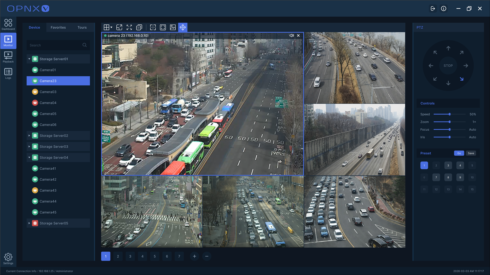
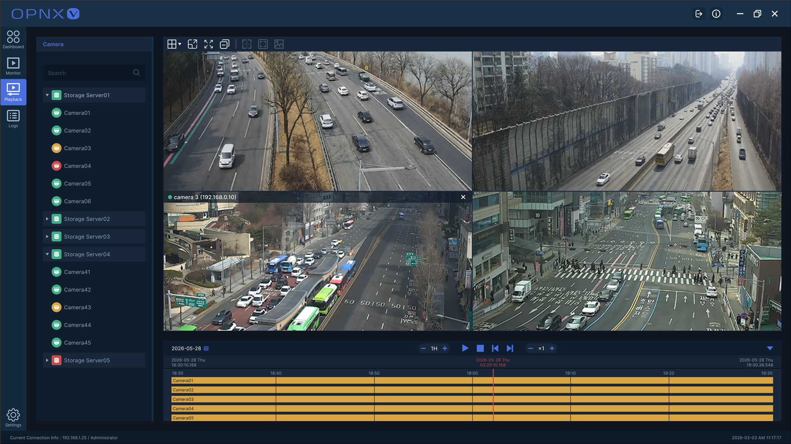

# OPNX.UI

[한국어](https://github.com/OPNXLabs/opnx-ui/blob/master/README.ko.md)

**WPF controls for video monitoring, multi-channel playback, and surveillance-oriented desktop applications.**

Direct3D video · Multi-view · Playback timeline · Device navigation · Operational controls

[NuGet](https://www.nuget.org/packages/OPNX.UI.WPF) · [Run the RTSP sample](https://github.com/OPNXLabs/opnx-samples#run-rtsp-viewer) · [Run the timeline sample](https://github.com/OPNXLabs/opnx-samples#run-playback-timeline) · [Commercial and OEM inquiries](#license-and-support)



## OPNX.UI In A Real VMS

OPNX.V uses OPNX.UI.WPF for its Windows monitoring and management clients. The controls shown above are the same reusable multi-view, video-presentation, navigation, selection, and operator-workflow foundations provided by this repository—not a disconnected UI mockup.



The recorded-video search screen combines multi-channel video review with `OpnxPlaybackTimeline`, channel recording ranges, time navigation, playback-rate selection, and synchronized playback orchestration supplied by the application layer.

## Start Here

```powershell
dotnet add package OPNX.UI.WPF --prerelease
```

Use [`OPNX.Samples.RtspViewer`](https://github.com/OPNXLabs/opnx-samples/tree/master/src/OPNX.Samples.RtspViewer) to evaluate live video and MultiView composition, or [`OPNX.Samples.PlaybackTimeline`](https://github.com/OPNXLabs/opnx-samples/tree/master/src/OPNX.Samples.PlaybackTimeline) to explore recorded ranges, events, selection, navigation, and styling.

> **License:** OPNX.UI is source-available, not open-source. Learning, research, testing, and non-commercial evaluation are permitted under [LICENSE.txt](https://github.com/OPNXLabs/opnx-ui/blob/master/LICENSE.txt). Commercial use, production use, redistribution, and OEM integration require prior written permission from OPNX.
> Internal non-production evaluation, proof of concept, and technical review by commercial organizations are also permitted. See the evaluation guidance below and the English license for scope.

OPNX.UI is the reusable .NET UI foundation for OPNX video clients. The current implementation is `OPNX.UI.WPF`, a Windows WPF control library for VMS, NVR, monitoring, playback, and review applications.

## Video UI Components That Are Usually Product Code

OPNX.UI packages difficult, domain-specific controls that are commonly rebuilt inside each VMS or NVR product:

- **Direct3D video presentation for WPF** — `OpnxImage` integrates Direct3D 9 surfaces through `D3DImage` for hardware-oriented frame presentation, with a double-buffered `WriteableBitmap` path for environments such as remote sessions.
- **A real playback timeline** — `OpnxPlaybackTimeline` presents recording ranges and event data across multiple channels, supports time-range navigation and selection, and exposes styling and layout controls for review applications.
- **Operational multi-view, not a uniform grid** — `OpnxMultiView` supports configurable and irregular cell layouts, split/merge-style layout operations, cell selection, zoom/full-screen flows, synchronized layout state, thumbnails, and Drag-and-drop content placement.
- **Controls for dense operator workflows** — hierarchical TreeList, paging, navigation, custom window chrome, selection primitives, and shared Drag-and-drop infrastructure complete the screens around the video itself.

These controls are reusable library components rather than screenshots or application-specific prototypes. They are designed to be composed with OPNX.Lib media, streaming, networking, and entity infrastructure.

## Why OPNX.UI Exists

Video clients repeatedly need dense multi-channel layouts, rendering-oriented image controls, playback timelines, hierarchical operational views, paged data navigation, custom window integration, and drag-and-drop infrastructure. OPNX.UI keeps those capabilities reusable instead of tying them to one product screen.

## Current Implementation

### OPNX.UI.WPF

`OPNX.UI.WPF` provides controls and infrastructure for:

- Multi-tile video display and rendering-oriented media presentation
- Recorded-media timelines, event ranges, selection, navigation, and review workflows
- Tree and flat-list surfaces with viewport-aware row density for operational data
- MVVM paging navigation with finely themeable page and movement states
- Determinate and indeterminate radial progress for wait and loading experiences
- Operational navigation, custom title bars, input primitives, and drag-and-drop
- Integration with OPNX.Lib-based media, networking, streaming, and data layers

## Core Video UI

### Direct3D Video Presentation

`OpnxImage` does not depend on repeatedly copying bitmaps into a standard WPF `Image`. It connects a Direct3D 9 surface to WPF through `D3DImage`, separating the continuously updated video surface from WPF layout in multi-channel live views. A double-buffered `WriteableBitmap` path is available for environments such as remote sessions where the Direct3D path cannot be used.

Frame decoding, conversion, and ownership remain in the OPNX.Lib media layer, while OPNX.UI focuses on presentation surfaces and WPF composition. The same rendering control can therefore be reused for live, playback, thumbnail, and analytics-result views.

### Operational MultiView

`OpnxMultiView` is not a simple uniform grid. It manages the video-cell layout behavior expected from VMS/NVR operations screens.

- Regular grids and irregular cell layouts
- Cell split/merge behavior and layout-state save/restore
- Single/multiple cell selection and selection highlighting
- Cell zoom, full-screen flow, and synchronized zoom state
- Cell and layout synchronization across multiple MultiView instances
- Thumbnail generation and drag-and-drop video placement
- Per-cell entity association and change events
- Tile-boundary theming through `CellBorderBrush` and `CellBorderThickness`
- Independent outer-edge control through `ShowOuterBorder`
- Connected internal-boundary dragging through `IsBoundaryResizeEnabled` and minimum tile sizing through `MinimumCellSize`
- Element transfer without disposal through `DetachCellElementAsync`

Layout and cell state remain in dedicated models, allowing applications to change views or persist user layouts without rebuilding the screen. The control can serve live monitoring, playback review, event walls, and multi-output workspaces.

Tile borders are arranged without doubling the shared edge between adjacent cells, so internal and outer lines use the configured thickness consistently. Setting `ShowOuterBorder="False"` hides only the outside edge; cell-selection and mouse-over outlines remain visible.

```xml
<opnx:OpnxMultiView Background="#080B10"
                    CellBorderBrush="#4D8FA3B8"
                    CellBorderThickness="1"
                    ShowOuterBorder="False" />
```

Boundary resizing is enabled by default, with a minimum tile width and height of 48 device-independent units. Connected boundaries move together, including merged-tile layouts; completed changes update layout synchronization. Set `IsBoundaryResizeEnabled="False"` to disable resizing.

Call `DetachCellElementAsync` on the UI thread and check its Boolean result before rehosting an element. On success, it detaches the element and its size bindings without disposing it or raising the removal event. A zoomed view is restored first; detachment can return `false` while zoom transitions or a held zoom prevent it. Applications manage the detached element's new host and eventual disposal. Separate-window creation and reattachment are application responsibilities.

### Multi-Channel Playback Timeline

`OpnxPlaybackTimeline` is a review control for navigating recording ranges and events from multiple channels on one time axis rather than a simple slider.

- Per-channel recording start/end ranges
- Event type, color, description, and merge information
- Navigation based on center time and visible time range
- Range-change and visible-data request events
- Recording/event hit testing and selection results
- A `PlaybackTimelineRateType` selection model for 0.25x, 0.5x, 1x, 2x, 4x, and 8x rates
- Themeable selected channels, row heights, recording bars, ticks, and separators
- Optional channel panel and entity-name presentation

The control does not need to own an entire recording history. It can request data for the currently visible time range, making it suitable for long-duration archives and multi-channel review workflows.

## Main Components

| Component | Purpose |
| --- | --- |
| `OpnxMultiView` | Configurable video-cell layouts, selection, zoom, synchronization, thumbnails, and Drag-and-drop |
| `OpnxImage` | Direct3D/D3DImage video surfaces with a remote-session-compatible buffered path |
| `OpnxImageViewer` | Video presentation and interaction built around `OpnxImage` |
| `OpnxPlaybackTimeline` | Multi-channel recording ranges, events, selection, time navigation, styling, and playback review |

## Supporting Operational Controls

OPNX.UI.WPF is more than a collection of video surfaces. It provides a themed control set for login, device and user management, configuration, log search, playback control, and runtime status. A typical NVR/VMS client can be built primarily with OPNX.UI.WPF without requiring a separate commercial WPF control suite.

| Area | Controls |
| --- | --- |
| Video presentation | `OpnxImage`, `OpnxImageViewer`, `OpnxMultiView`, `OpnxPlaybackTimeline` |
| Data presentation | `OpnxTreeListView`, `OpnxPagingControl` |
| Text and value input | `OpnxTextBox`, `OpnxPasswordBox`, `OpnxNumericBox`, `OpnxIpTextBox` |
| Dates, time, and selection | `OpnxComboBox`, `OpnxCheckBox`, `OpnxRadioButton`, `OpnxDatePicker`, `OpnxTimePicker`, `OpnxDateRangeSelector`, `OpnxStepSelector` |
| Commands | `OpnxButton`, `OpnxToggleButton`, `OpnxArcButton`, `OpnxRoundRectButton` |
| Application structure | `OpnxNavigator`, `OpnxTabControl`, `OpnxTabItem`, `OpnxTitlebar` |
| Progress and status | `OpnxRadialProgressBar` |
| Notifications and tray | `OpnxNotification`, `OpnxNotificationService`, `OpnxNotifyIcon` |
| Taskbar | `Infrastructure.WindowTaskbar` |
| Shared foundations | `Controls.Primitives`, drag-and-drop, and selection building blocks |

`OpnxTreeListView` supports parent/child tree presentation and a flat-list mode. With `RowSizingMode="FitViewport"` and `FitRowCount`, it can calculate row height so a fixed page size fills the current viewport, reducing excessive empty space on large displays and avoidable scrolling on smaller layouts.

`SearchText` performs the built-in search over displayed columns, while `Filter` accepts an application predicate. Tree rebuilds caused by search or source-collection changes restore expansion state and safely complete pending edits. `ColumnHeaderSpacing` controls the gap between the header and first row, independently of inter-row `RowSpacing`.

```xml
<opnx:OpnxTreeListView ItemsSource="{Binding Items}"
                       ViewMode="Flat"
                       RowSizingMode="FitViewport"
                       FitRowCount="20"
                       SearchText="{Binding SearchText}"
                       Filter="{Binding ItemFilter}"
                       ColumnHeaderSpacing="7"
                       RowSpacing="7" />
```

`OpnxPagingControl` preserves the external view model for `SelectedPageNumber` and `MaxPageNumber` while managing page items and Next/Previous state. Normal, selected, and disabled pages plus movement-button backgrounds, foregrounds, and mouse-over/pressed opacity can be themed independently.

`OpnxComboBox` separates the main control and dropdown-panel backgrounds, borders, and interaction colors, making it suitable for dense checkable-filter interfaces. In addition to `PlaceholderTextMargin`, `TextMargin` controls the inset of ordinary selected text. `OpnxRadialProgressBar` provides determinate and indeterminate progress without application-specific behavior and can be used in splash screens, wait overlays, and long-running task indicators.

`OpnxNavigatorItem` supports unread/status badges through `IsBadgeVisible`, `BadgeBrush`, `BadgeSize`, alignment, and margin options.

### Notifications, Tray, And Time Input

`OpnxNotificationService` manages desktop popups containing WPF content. Options include visible-item limits, duration, screen/position, spacing, and pause on mouse-over. These are WPF notification windows, separate from Windows system toast notifications.

`OpnxNotifyIcon` provides a tray icon, Open/Exit menus, and window hide/restore behavior. `OpnxNotifyIconOptions` controls menu visibility and themes; dispose the icon when finished. `Infrastructure.WindowTaskbar` sets a window's application ID and flashes its taskbar entry.

`OpnxTimePicker` exposes a `TimeSpan`-based `SelectedTime` with `Minimum`/`Maximum` bounds. `OpnxDatePicker` controls date presentation through `DisplayFormat` and `CalendarButtonVisibility`. `OpnxRadioButton` joins the themed selection controls.

ComboBox separates main-control and dropdown-selection backgrounds; `DropDownItemForeground` and `DropDownItemSelectedForeground` configure normal/selected item text. Current source uses FFmpeg bindings `9.0.1.1`; native libraries must match the ABI and process architecture.

## Design Direction

- Controls target dense operational interfaces such as VMS/NVR clients.
- Public behavior remains reusable across products rather than one application screen.
- OPNX.UI works with OPNX.Lib without duplicating application-specific logic.
- Additional .NET UI stacks may be added later, but only `OPNX.UI.WPF` is currently implemented.
- Public APIs remain preview quality while samples and integration contracts mature.

## Current Status

OPNX.UI is under active development. The current package is intended for preview evaluation, integration testing, research, non-commercial experimentation, and early feedback rather than as a stable production UI SDK.

## NuGet Package And Build

```powershell
dotnet add package OPNX.UI.WPF --prerelease
dotnet build OPNX.UI.slnx -c Debug
dotnet pack .\src\OPNX.UI.WPF\OPNX.UI.WPF.csproj -c Release -p:Platform=x64
```

Requirements: .NET 10 SDK and a Windows development environment with WPF support. The library targets `net10.0-windows7.0`; the target framework name alone does not guarantee that the .NET runtime and native dependencies support every Windows version.

Release selects the optimized build configuration; the `-preview` version suffix keeps the package a prerelease. The package date defaults to the local build date. For repeatable packaging, pass `-p:PreviewDate=yyyyMMdd -p:PreviewRevision=1` with the intended date; use a higher revision for another package on that date. The revision is independent of the Lib package revision.

The default `OpnxLibVersion` is currently `0.1.0-preview.20261106.3`. To validate a newer Lib package, add its folder as a local NuGet source, select its exact version through `-p:OpnxLibVersion=<version>`, and use the same value for restore and build/pack. Before publishing UI, update its default Lib reference to the validated version and check the generated `.nuspec` dependency. Dev-solution builds alone do not validate NuGet consumption.

After packaging, check that the archive includes both READMEs, `LICENSE.txt`, `LICENSE.ko.txt`, `THIRD-PARTY-NOTICES.md`, and the referenced third-party license files. README images use public absolute URLs supported by NuGet.org; publish the linked repository files before uploading the package and preview the README on NuGet.org.

- `OPNX.UI.slnx` uses the configured published OPNX.Lib package.
- `OPNX.UI.Dev.slnx` uses sibling local OPNX.Lib source projects for cross-repository development.

## Source And Published Package Scope

Capabilities in this README describe current repository source. Previously published preview NuGet packages may contain earlier APIs and dependencies; check the selected version and its dependency graph. Public Samples use OPNX.Lib `0.1.0-preview.20261106.3` and OPNX.UI.WPF `0.1.0-preview.20261107.1` for reproducible execution. Check the Samples [Directory.Build.props](https://github.com/OPNXLabs/opnx-samples/blob/master/Directory.Build.props) for the current pins; the samples do not demonstrate every capability in current source.

## Samples And Documentation

Find seven runnable examples and current UI screenshots in [OPNX Samples](https://github.com/OPNXLabs/opnx-samples). They consume published NuGet packages and do not require private OPNX.V projects.

| Sample | What to evaluate |
| --- | --- |
| [`RtspViewer`](https://github.com/OPNXLabs/opnx-samples#run-rtsp-viewer) | RTSP input, FFmpeg decoding, MultiView layout, zoom, capture and detached video windows |
| [`WebRtcViewer`](https://github.com/OPNXLabs/opnx-samples#run-webrtc-viewer) | H.264 RTSP-to-WebRTC bridge, embedded WebView2/browser playback and receive statistics |
| [`PlaybackTimeline`](https://github.com/OPNXLabs/opnx-samples#run-playback-timeline) | Simulated multi-channel recordings/events, time navigation, selection and appearance settings |
| [`ControlGallery`](https://github.com/OPNXLabs/opnx-samples#run-control-gallery) | WPF input, selection, dates/time, tree/list search, paging, notifications and tray integration |
| [`SystemMonitoring`](https://github.com/OPNXLabs/opnx-samples#run-system-monitoring) | Live CPU, memory, current-process, network, disk-capacity and supported GPU metrics |
| [`ProtocolChat`](https://github.com/OPNXLabs/opnx-samples#run-protocol-chat) | TCP / Named Pipe / SharedMemory chat, shared request/response, timeout and cancellation logic |
| [`EntityStore`](https://github.com/OPNXLabs/opnx-samples#run-entitystore) | In-memory CRUD, immutable row changes, property notifications and tracked-instance identity |

The five WPF samples share OPNX.UI styles, OPNX.V Dark / Graphite / Light themes and Blue / Teal / Amber accents. WebRtcViewer uses an HTML `<video>` player in WebView2; ProtocolChat and EntityStore are console examples. RtspViewer requires compatible FFmpeg native DLLs; WebRtcViewer requires the WebView2 Runtime and an H.264 source. PlaybackTimeline uses simulated data and does not play recorded media.

## Evaluation And Code Reuse

- Personal learning, research, testing, and non-commercial evaluation are permitted.
- Internal non-production evaluation, proof of concept, and technical review by a commercial organization are also permitted under the license without separate written permission.
- Production use, customer-facing services, commercial/OEM integration, and redistribution require prior written permission.
- Permission to modify evaluation code does not grant permission to include it in a commercial product or redistribute modified copies.
- OPNX-owned code and dependencies have separate licenses. The repository's English license controls the final terms.

## License And Support

OPNX.UI is source-available but is not permissively licensed open-source software. Commercial use, redistribution, OEM integration, or inclusion in commercial products requires prior written permission from OPNX. See [LICENSE.txt](https://github.com/OPNXLabs/opnx-ui/blob/master/LICENSE.txt), [LICENSE.ko.txt](https://github.com/OPNXLabs/opnx-ui/blob/master/LICENSE.ko.txt), and [THIRD-PARTY-NOTICES.md](https://github.com/OPNXLabs/opnx-ui/blob/master/THIRD-PARTY-NOTICES.md).

- Website: [https://www.opnx.kr/](https://www.opnx.kr/)
- Contact: `opnx@opnx.kr`
- Security: [SECURITY.md](https://github.com/OPNXLabs/opnx-ui/blob/master/SECURITY.md)
- Contributions: [CONTRIBUTING.md](https://github.com/OPNXLabs/opnx-ui/blob/master/CONTRIBUTING.md)

## Related Projects

- [OPNX Samples](https://github.com/OPNXLabs/opnx-samples) — runnable OPNX.Lib and OPNX.UI examples
- `OPNX.Lib` — networking, media, streaming, data, and system infrastructure
- `OPNX.V` — video-platform applications built on OPNX.Lib and OPNX.UI

---

> **“Have not I commanded thee? Be strong and of a good courage; be not afraid, neither be thou dismayed: for the LORD thy God is with thee whithersoever thou goest.”**
>
> — Joshua 1:9, King James Version (KJV)
